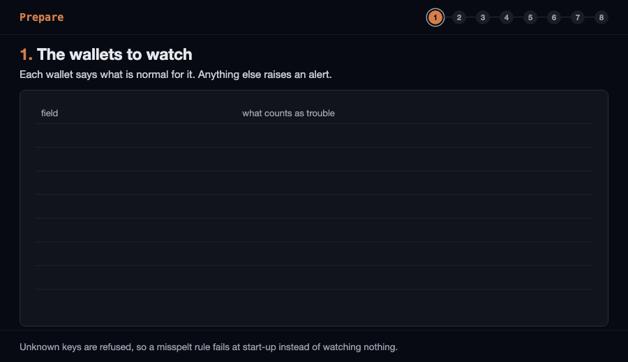

# @globalmpc/hot-wallet-watch

Built by [MPC (Mineral Project Coin)](https://www.globalmpc.tech) — mining real-world asset (RWA) infrastructure.

Watch hot wallets for the signs of a takeover, block by block: an EIP-7702 delegation to a contract you did not approve, code appearing at the address, a nonce rising without your own send, and native or token outflows above a set rate. Every reading is cross-checked across independent RPC endpoints, and any one of them seeing trouble raises the alarm. Built on [`@globalmpc/evm-log-walker`](../evm-log-walker). Node 22.14 or newer (CI runs the current Node 22).

### How it works



```sh
npm install @globalmpc/hot-wallet-watch
```

## Why

In the [largest crypto theft on record](https://www.trmlabs.com/resources/blog/north-korea-steals-usd-6-36-billion-from-binance-in-the-largest-hack-in-history) (October 2026, about $6.36B), an EIP-7702 delegation handed an exchange hot wallet to a sweeper contract. The wallet's balance left within minutes, and the sweeper kept taking new deposits for more than three hours afterwards (20:41, 20:59, 21:04, 21:44, 22:39 and 23:56 UTC). The delegation was visible on chain from the first block: the wallet's address suddenly had code, `0xef0100` followed by the sweeper's address.

A watcher reading that address every few seconds sees the delegation within a block or two, and a response on that signal (stop routing deposits there, pause the service, broadcast a reset) keeps everything that arrives afterwards. It cannot stop the first sweep; keeping the key from signing the delegation at all is [`@globalmpc/sign-guard`](../sign-guard)'s job. The two are meant to be used together.

## Example

```ts
import { createRpc } from "@globalmpc/evm-log-walker";
import { watch } from "@globalmpc/hot-wallet-watch";

await watch({
  // One client per independent provider. No retries and a short timeout: the next pass is the retry,
  // and a hung provider must not pile up calls behind the watcher's own deadline.
  endpoints: [process.env.RPC_A!, process.env.RPC_B!].map((url) => createRpc({ urls: url, retries: 0, timeoutMs: 5_000 })),
  chainId: 56, // an endpoint on another chain is left out
  wallets: [
    {
      address: "0x…relayer",
      label: "relayer",
      expectedNonce: () => db.countSentTransactions("relayer"), // a higher nonce on chain: someone else signed
      outflow: { durationMs: 3_600_000, max: 10n ** 17n },       // 0.1 BNB an hour, net of deposits
    },
    { address: "0x…treasury", label: "treasury", frozen: true }, // must never send
  ],
  onAlert: async (alert) => {
    await pager.send(alert.severity, alert.message);
    if (alert.severity === "critical") await relayer.pause(alert.wallet?.label);
  },
});
```

`watch` runs pass after pass, waiting `intervalMs` (3 seconds) between them, until its `signal` aborts. Each endpoint has `requestTimeoutMs` (10 seconds) for its head and the same again for its wallet reads, so a pass lasts at most about twice that, plus up to 10 seconds for `expectedNonce`. An alert is sent when it first appears, again at once when it gets worse (a larger outflow, a higher nonce), and every `repeatAfterMs` (10 minutes by default) while it stays true; when a pass no longer raises it, it is forgotten, so its return is sent at once. A callback that throws is retried on the next pass, even if the alert's condition has cleared, until it is delivered; one that takes longer than `callbackTimeoutMs` (10 seconds) is cut off and counted as sent, since it may have been. Either way a broken pager never stops the watch. For one pass, `createWatcher(options).check()` returns the full `Report`.

## What it raises

| `kind` | Severity | Raised when |
|---|---|---|
| `delegated` | critical | The wallet carries an EIP-7702 delegation to a contract not in its `delegates`. `detail.delegate` names it. |
| `unexpected-code` | critical | Contract code at an address that should have none. Set `contract: true` for a smart-contract wallet. |
| `unexpected-nonce` | critical | The nonce is above `expectedNonce()`, or a `frozen` wallet's nonce rose after the first reading: someone signed with the key. |
| `outflow` | critical | More native value, or more of a `tokens` entry, left the wallet within the window than its cap allows. `detail.amount` is the total in the window, `detail.fall` this pass's own fall; a new fall sends the alert again at once. |
| `wallet-unreadable` | critical | No endpoint could read the wallet this pass: it is not being watched. |
| `no-endpoint` | critical | No endpoint answered at all. |
| `token-unreadable` | critical | No endpoint could read a watched token's balance this pass, so its outflow cap is not being watched. |
| `endpoints-disagree` | warning | Endpoints gave different readings for the same block. |
| `endpoint-failed` | warning | One endpoint failed, timed out, is on another chain, or answered something malformed (`detail.token` when only a token read failed); the others decided. |
| `endpoint-lagging` | warning | One endpoint's head is more than `maxLagBlocks` (default 20) behind the newest. It is still read, and can still raise the alarm. |
| `expected-nonce-failed` | warning | `expectedNonce` threw, took more than 10 seconds, or returned something other than a whole number. |

Every alert names the wallet, the block, the endpoints that saw it by position (`endpoint-1`, …, never by URL, since a host can carry a key), and plain `detail` values with amounts as decimal strings.

## How a pass reads the chain

1. Every endpoint is asked for its chain id and head. One on another chain, or one that does not answer within `requestTimeoutMs` (10 seconds), is left out of the pass with a warning.
2. Each remaining endpoint reads each wallet at its own head: `eth_getCode`, `eth_getTransactionCount`, `eth_getBalance`, and `balanceOf` for each token. A malformed answer is a failed reading, never a clean one; a failed token read is reported on its own and does not cost the wallet its code and nonce checks.
3. **Every endpoint is judged on its own, and the alarm wins.** A delegation or code seen by any endpoint is raised, and so is a nonce above the baseline on any endpoint. For outflows, each endpoint's balance is compared with its own last reading, so one that lies, lags or always reports a low balance can only blind itself. An endpoint that missed the last pass is compared with the higher of its own last reading and the highest balance any endpoint reported then, so a drain while it was away still counts. Each pass adds the largest fall any endpoint measured to one window per wallet and asset, so a drain seen in parts by endpoints taking turns still adds up. A frozen wallet has one baseline, the lowest nonce any endpoint reported on the first pass, so an inflated reading cannot raise it.
4. A reading from behind the same endpoint's last head, as a load balancer answering from a lagging or stuck node gives, is skipped for outflows. Three such readings in a row, during which the chain advanced, which is what a real chain below a bogus inflated head looks like, restart that endpoint's series, counting any fall since its last good reading; a stuck node repeating one head never does. One bogus head delays detection by at least two passes, and until the chain has advanced a block: longer on chains with blocks slower than `intervalMs`.
5. Endpoints at the same head are compared, and a difference is a warning.

## Responding to a delegation

`@globalmpc/sign-guard`'s `presignResets` signs "clear my delegation" authorizations for the next nonces while the key is safe. When `delegated` fires, any funded account can broadcast the one matching the wallet's current nonce:

```ts
// sponsor: any viem wallet client with gas. reset: the stored authorization for the current nonce.
await sponsor.sendTransaction({ to: walletAddress, authorizationList: [reset] });
```

It is a first response, not a guarantee: the delegate's code runs as the wallet, and every contract it creates raises the wallet's nonce, so a delegate built for it can move the nonce past the stored range first. Stopping new deposits from reaching the wallet does not depend on the nonce, so do that too.

## Command line

`check` runs one pass, for a cron job or a quick look:

```sh
npx --package @globalmpc/hot-wallet-watch hot-wallet-watch check \
  --rpc https://bsc-rpc.publicnode.com --rpc https://bsc-dataseed.bnbchain.org \
  --wallet 0x…relayer=relayer
```

```
block 130844536, read from endpoint-1, endpoint-2
relayer: delegated to 0x…, nonce 78333459, balance 0 wei
CRITICAL delegated: relayer is delegated to 0x…, which is not an allowed delegate: that contract now controls the wallet
```

`--allow-delegate <address>` allows a delegate for every wallet given; `--chain-id <n>` sets the chain (default 56, BNB Smart Chain); `--json` prints the report. Exit codes: 0 no alert, 10 warnings only, 20 at least one critical alert, 1 usage error, 2 no endpoint answered.

`watch --config watch.json` runs pass after pass and prints each alert as one JSON line, to pipe into whatever sends your alerts. It stops on Ctrl-C (exit 0); a usage or config error exits 1; if whatever reads its output goes away, it says so on stderr and exits 3, so a supervisor can restart it (`check` exits 3 the same way).

```json
{
  "rpc": ["https://bsc-rpc.publicnode.com", "https://bsc-dataseed.bnbchain.org"],
  "chainId": 56,
  "intervalMs": 3000,
  "wallets": [
    { "address": "0x…relayer", "label": "relayer", "outflow": { "durationMs": 3600000, "max": "100000000000000000" } },
    { "address": "0x…treasury", "label": "treasury", "frozen": true }
  ]
}
```

Amounts are decimal strings in base units. `expectedNonce` cannot be written in JSON; use `frozen`, or the library. Put a keyed endpoint in `HOT_WALLET_WATCH_RPC` (space-separated) rather than on the command line, where shell history and the process list would show it. Endpoints come from `--rpc` first, then that variable, then the config's `rpc`.

## API

- `watch(options)`: the loop above. `options` are `createWatcher`'s plus `onAlert`, `onReport?`, `intervalMs?`, `repeatAfterMs?`, `callbackTimeoutMs?`, `signal?`.
- `createWatcher({ endpoints, chainId, wallets, maxLagBlocks?, requestTimeoutMs?, maxConcurrentRequests?, now? })`: `check()` runs one pass and returns a `Report`. Never throws for anything the chain does, and lasts at most about twice `requestTimeoutMs` plus up to 10 seconds for `expectedNonce`; everything that goes wrong is an alert. Keep one watcher for repeated passes: the outflow series and frozen baselines live in it. Its default clock is monotonic, so a wall-clock step cannot drop or freeze a window; `Report.at` is wall time unless you pass `now`. Each endpoint gets at most `maxConcurrentRequests` (8) requests in flight at once, counted until each call really settles, so a pass over many wallets stays under public rate limits; once an endpoint has used up its `requestTimeoutMs` for the pass, its remaining reads fail at once, unsent. Timer options are capped at 2,147,483,647 ms.
- `WalletSpec`: `{ address, label?, delegates?, contract?, frozen?, expectedNonce?, outflow?, tokens? }`. Unknown keys are refused.
- `configFromJson(text)`: the CLI's config format.
- `classifyCode(code)`: `none`, `delegated` (with the delegate) or `contract`.

## What it does not do

- **It does not prevent anything.** It sees a takeover and tells you; deciding what the key may sign is [`@globalmpc/sign-guard`](../sign-guard)'s job.
- **Outflows are net balance changes between passes.** A deposit and a withdrawal inside one pass offset each other; a slow drain under the cap is not raised. Set caps from what the wallet really moves.
- **Outflow totals err high.** An endpoint returning from an outage is measured from the higher of its own last reading and the highest balance any endpoint reported on the last pass, so part of a fall can be counted twice when endpoints take turns failing, and one that inflates balances can make it look drained; a lagging endpoint can also count a fall a pass after another endpoint did. Both raise the alarm rather than miss a drain; `endpoint-failed`, `endpoint-lagging` and `endpoints-disagree` name the endpoints involved.
- **A frozen wallet's baseline is the first pass.** Start watching before anything can have happened.
- **It does not judge a delegate.** A listed delegate is trusted as listed.
- **It polls.** Readings are as fresh as `intervalMs` and the endpoints' heads.

## Development

```sh
pnpm --filter @globalmpc/hot-wallet-watch check   # typecheck, test, build
```

Tests run against in-memory chains; nothing touches the network.

## License

MIT
