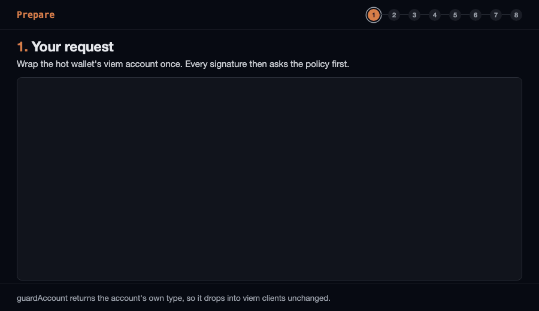

# @globalmpc/sign-guard

Built by [MPC (Mineral Project Coin)](https://www.globalmpc.tech) — mining real-world asset (RWA) infrastructure.

A signing policy for hot wallets. It wraps a viem account so every transaction, EIP-7702 authorization, typed-data and message signature is checked against a written allowlist before the key is used: pinned chain ids, the contracts and functions the key may call, native and token spend caps per transaction and per time window, and no blind hash signing. Anything the policy does not name is refused. No runtime dependencies. Node 22.14 or newer (CI runs the current Node 22).

### How it works



```sh
npm install @globalmpc/sign-guard
```

## Why

A hot wallet's key signs whatever it is handed. When the machine or service that hands it requests is compromised, the attacker does not need to steal the key: asking it is enough. In the [largest crypto theft on record](https://www.trmlabs.com/resources/blog/north-korea-steals-usd-6-36-billion-from-binance-in-the-largest-hack-in-history) (October 2026, about $6.36B across ten chains), the attacker had a hot wallet sign 50 EIP-7702 authorizations in advance, one for each upcoming nonce, delegating the account to a sweeper contract; once one landed, the sweeper drained the wallet and kept sweeping deposits for hours. On nine other chains the same signing system produced ordinary transfers for the attacker. A single transaction moved more than $2.5B.

Every one of those signatures breaks a rule a policy can state in advance: delegate only to a contract you name, never more than one delegation an hour, never send a token to an address you did not list, never more than a set amount per transfer or per hour.

## Example

```ts
import { privateKeyToAccount } from "viem/accounts";
import { createWalletClient, http, parseEther } from "viem";
import { bsc } from "viem/chains";
import { guardAccount } from "@globalmpc/sign-guard";

const account = guardAccount(privateKeyToAccount(process.env.RELAYER_KEY as `0x${string}`), {
  chainIds: [56],
  transactions: {
    calls: [{ to: "0x…yourContract", selectors: ["0x183ff085"] }],          // checkIn() and nothing else
    tokens: [{ token: "0x…usdt", maxAmount: 500n * 10n ** 18n,            // 500 per transfer
               window: { durationMs: 3_600_000, max: 2_000n * 10n ** 18n } }], // 2,000 per hour
    maxValue: parseEther("0.01"),
    window: { durationMs: 3_600_000, max: parseEther("0.05") },
  },
  typedData: [{ verifyingContract: "0x…yourContract", primaryTypes: ["ClaimPermit"] }],
}, {
  onDecision: (decision) => auditLog.write(decision),   // every decision, allowed or refused
});

const wallet = createWalletClient({ account, chain: bsc, transport: http() });
await wallet.writeContract({ /* checkIn on yourContract: signed */ });
await wallet.sendTransaction({ to: "0x…anyoneElse", value: 1n }); // throws; the cause is SignGuardError E_DENIED
```

`guardAccount` returns the account's own type, so it drops into `createWalletClient`, `writeContract` and every other viem call unchanged. It takes local accounts only (`privateKeyToAccount`, `mnemonicToAccount`, `toAccount` over your own signer): viem signs a JSON-RPC account through the node, outside any guard, and it would also fall back to the node for a signing method an account lacks, so every missing method is installed as one that refuses. A refused request throws a `SignGuardError` with `code: "E_DENIED"` and a `decision` naming the rule; nothing is signed. Through a viem client, some actions (`sendTransaction`, `writeContract`, `deployContract` and others) wrap the refusal in their own error, while others such as `signMessage` throw it as it is. Always use `findRefusal(error)` rather than `instanceof`: it returns the `SignGuardError` either way, or undefined.

On a chain whose viem definition carries its own transaction serializer (Base and Optimism do; BNB Smart Chain and opBNB do not), the wallet client hands that serializer to `signTransaction`. A serializer decides the bytes that are signed, so an unknown one is refused; trust the chain's own by identity: `guardAccount(account, policy, { trustedSerializers: [base.serializers.transaction] })`.

## Where the guard has to run

**The guard only protects what goes through it.** Inside the same process as the code that asks for signatures, it stops a bug, a malicious dependency calling the account, or a crafted request reaching the signer. It does not stop an attacker who controls that process: they can read the key from the environment and skip the wrapper.

Real protection comes from running the guard where the key lives, apart from what asks for signatures: a small signing service that holds the key, applies this policy, and answers the application over an authenticated channel. The application never sees the key; the attacker who owns the application can only ask, and the policy answers. `createSignGuard` and `evaluate` are there for that case, or for a KMS or MPC co-signer that is not a viem account at all:

```ts
import { createSignGuard, policyFromJson } from "@globalmpc/sign-guard";

const guard = createSignGuard(policyFromJson(await readFile("policy.json", "utf8")));

const decision = await guard.check({ kind: "transaction", transaction: incoming });
if (!decision.allowed) return refuse(decision);                   // decision.rule, decision.reason
const { request } = decision;                                      // the copy that was judged
if (request.kind === "transaction") return kms.sign(request.transaction);
```

Sign `decision.request`, never the incoming object: it is a plain copy of the signable fields, each read once before the check, so nothing that changes the incoming request afterwards reaches the signature. Do not give a window back when a remote signer fails: it may have signed before the error (a timeout), and refunding then lets a caller collect signatures past the cap. Call `guard.release(decision)` only when you know nothing was signed.

Give each chain and each wallet tier its own key and its own policy. One signer that holds keys for ten chains can be made to sign on all ten.

## The policy

Everything not named is refused. A policy with only `chainIds` signs nothing but delegation resets, which are capped by `authorizations.resetWindow`.

| Field | Default | Meaning |
|---|---|---|
| `chainIds` | required | Chains a signature may be valid on. Chain id 0 is refused: it would mean every chain. A policy that names contracts (`calls`, `tokens`, `authorizations.allow`, `typedData`) has exactly one: the same address can be a different contract on another chain. |
| `transactions.calls` | none | `{ to, selectors }`: contracts the key may call and the 4-byte functions it may call there. `"0x"` means no calldata (a plain value send to `to`). There is no wildcard. |
| `transactions.tokens` | none | `{ token, maxAmount, window?, recipients? }`: an ERC-20 the key may send with `transfer(address,uint256)`, capped per transfer and per window, optionally only to listed recipients. Other functions on the token, `approve` included, need a `calls` entry. |
| `transactions.maxValue` | `0n` | Largest native value per transaction, in wei. |
| `transactions.window` | none | `{ durationMs, max }`: native value allowed in any sliding window. |
| `transactions.allowContractCreation` | `false` | Whether a transaction without `to` may be signed. |
| `authorizations.allow` | none | Contracts the account may delegate to under EIP-7702. |
| `authorizations.window` | 1 per hour | `{ durationMs, max }`: how many delegations may be signed per window. |
| `authorizations.resetWindow` | 25 per hour | `{ durationMs, max }`: how many delegation resets may be signed per window. |
| `typedData` | none | `{ verifyingContract, name?, primaryTypes }`: EIP-712 messages the key may sign, on the policy's chain. |
| `messages.prefixes` | none | Text messages (`personal_sign`) that start with one of these strings. |

Amounts are bigints in base units. Unknown keys are refused, so a misspelt field fails at start-up instead of leaving the key with limits nobody wrote down. For a policy kept in a file, `policyFromJson` reads the same shape with amounts as decimal strings (`"maxAmount": "500000000000000000000"`).

## The rules

Each decision carries a stable `rule`:

| `rule` | Refused because |
|---|---|
| `hash.denied` | A raw 32-byte digest was asked for. Always refused: a digest can be a transaction, a delegation or a permit, and nothing shows which. |
| `method.unknown` | A method the guard does not know, such as viem's `getHdKey`, was called through the wrapper; a signing method the account lacks; or a request `kind` the guard does not know. |
| `chain.not-allowed` | A transaction with no chain id, or any request on a chain outside `chainIds` (delegation resets included). Typed data or an authorization with no usable chain id is refused as malformed instead. |
| `transaction.malformed` | `chainId`, `to`, `value`, `data` or `authorizationList` of the wrong shape. |
| `transaction.custom-serializer` | The caller passed its own serializer, which could sign other bytes than the fields checked. |
| `transaction.input-field` | The transaction has `input`; calldata belongs in `data`, the field that is signed. |
| `transaction.type-not-allowed` | A blob transaction or an unknown type. |
| `transaction.creation-not-allowed` | No `to`, which deploys a contract. |
| `transaction.value-over-limit` | Native value above `maxValue`. |
| `transaction.target-not-allowed` | `to` is neither a `calls` contract nor a `tokens` token. |
| `transaction.function-not-allowed` | The function selector is not listed for that contract. |
| `transaction.authorization-list` | The transaction carries an EIP-7702 authorization that the rules below would refuse, or one without `address`. |
| `token.malformed-transfer` | Transfer calldata that is not exactly `transfer(address,uint256)`. |
| `token.amount-over-limit` / `token.recipient-not-allowed` | Above `maxAmount`, or to an address outside `recipients`. |
| `authorization.malformed` | No valid contract address, two that disagree (`address` and `contractAddress`), or a chain id or nonce that is not a whole number. |
| `authorization.chain-zero` | A delegation valid on every chain. |
| `authorization.delegate-not-allowed` | A delegation to a contract outside `authorizations.allow`. |
| `typed-data.not-allowed` / `typed-data.malformed` | No matching rule; or no chain id, no primary type, or an `EIP712Domain` type that differs from the one the domain implies (which can leave the chain id or contract out of what is signed). The exact derived type, which viem's wallet client always sends, is accepted. |
| `message.not-allowed` / `message.raw` | No allowed prefix; raw bytes. |
| `window.exceeded` | The request fits every rule but would pass a window limit. |
| `audit.failed` | `onDecision` threw: a signature that could not be recorded is not produced. |
| `clock.invalid` | The clock returned something other than a whole, non-negative number of milliseconds; no window can be checked. |
| `ledger.failed` | The spend ledger threw (unreachable, or a key used with two window lengths) or answered something other than `true` or `false`; the reason carries its message, and anything already reserved for the request is given back. |
| `request.malformed` | The request is not an object, a message is missing, or the request could not be copied (a function or proxy in a signed field, a getter that throws). Refused and recorded, never thrown. |

An authorization to the zero address clears a delegation instead of setting one. It is allowed on a policy chain (never chain id 0) and needs no entry. Resets have their own window, 25 per hour by default: a reset cannot move funds, but each one, broadcast, uses up a nonce of the account.

## Undoing a delegation without the key

```ts
import { presignResets } from "@globalmpc/sign-guard";

// While the key is safe: sign "clear my delegation" for the next 20 nonces, and store the result offline.
const resets = await presignResets(account, { chainId: 56, fromNonce: currentNonce, count: 20 });
```

If a hostile delegation lands later, any funded account can broadcast the reset whose nonce matches the wallet's current one in an EIP-7702 transaction (`authorizationList: [reset]`) and the delegation is gone. It is a first response, not a guarantee: the delegate's code runs as the wallet, and every contract it creates raises the wallet's nonce, so a delegate built for it can move the nonce past the whole set before a reset lands. Speed matters, which is why detection belongs next to it. A reset cannot move funds or grant control. A stolen set can still be a nuisance: broadcasting one clears any delegation and uses up the nonce it names, dropping a pending transaction at that nonce, so keep the set out of public reach. They stay usable while the wallet's nonce is inside the range; sign a new set when it moves past. Sign the set with the raw account while it is safe, or, signing through the guard, keep `count` within the room left in `authorizations.resetWindow`. That window belongs to the guard's ledger and scope: an attempt whose signature fails still counts unless `releaseOnSignerError` gives it back, and guards of one key share it only when they share a ledger and scope.

## Command line

`sign-guard check` validates a policy file and runs requests through it, so a policy can be tested in CI without a key:

```sh
npx --package @globalmpc/sign-guard sign-guard check --policy policy.json requests.json
```

```
policy is valid; 2 allowed, 2 refused
1. transaction: allowed (call allowed by the policy)
2. transaction: allowed (token transfer within the policy)
3. transaction: REFUSED window.exceeded (token:56:0x… would pass its limit of 1500 per 3600000 ms)
4. authorization: REFUSED authorization.delegate-not-allowed (delegating this account to 0x… is not allowed: …)
```

Requests are judged in order with the windows applied; `--step <ms>` moves the clock between them, `--now <ms>` sets the start, `--json` prints the decisions as JSON. Exit codes: 0 every request allowed (or a valid policy and no requests), 20 at least one refused, 1 usage error or invalid policy or request file, 2 a file could not be read.

## API

- `guardAccount(account, policyOrGuard, { trustedSerializers?, releaseOnSignerError?, ...guardOptions })`: the account, with every signing method checked first. The signable fields are copied before the check and the copy is what is signed, so a request object that changes after it was checked, or a getter that answers differently the second time, cannot slip through. Transactions are signed from the standard Ethereum fields only; chain-specific extras are dropped. When the wrapped signer throws, the window amounts stay spent, because a remote signer can sign and still fail (a KMS timeout); set `releaseOnSignerError` for a local private-key account, where an error means nothing was signed. `trustedSerializers` is copied when the account is wrapped.
- `findRefusal(error)`: the `SignGuardError` refusal inside an error or its causes.
- `createSignGuard(policy, { ledger?, scope?, now?, onDecision? })`: `check(request)` copies the signable fields once, judges the copy, reserves window amounts when allowed, and returns a `Decision` whose `request` is that copy; sign it. `onDecision` gets its own copy, so it cannot change what is signed. `release(decision)` returns the amounts when you know no signature was made, once per decision. The resolved policy stays inside the guard, so nothing handed out can widen it. The clock defaults to `Date.now`, which every process on a host agrees on.
- `evaluate(request, resolvedPolicy)`: the policy alone, pure, no windows.
- `resolvePolicy(policy)`: validates a policy and fills defaults; `createSignGuard` calls it.
- `policyFromJson(text)`, `requestsFromJson(text)`: the JSON forms used by the CLI.
- `createMemoryLedger()`, `SpendLedger`: where window amounts are recorded (see below).
- `presignResets(account, { chainId, fromNonce, count })`: signed authorizations that clear a delegation.

### Windows across processes

The default ledger lives in the signing process's memory and empties when it restarts. One process per key makes it exact. If several processes sign with the same key, implement `SpendLedger` over shared storage (a database row under a lock, a Redis script) so `reserve` stays atomic across them; otherwise each process enforces the full window on its own. When several keys share one ledger, give each key its own `scope`, such as its address, so their windows stay apart. Guards of the same key (one policy per chain) should share one ledger and the key's scope, with the same `authorizations.window` and `resetWindow`: the delegation and reset caps then hold per key, while native and token windows are already kept per chain. A ledger key is bound to one window length; the memory ledger refuses a second length (`ledger.failed`) rather than let the shorter window erase what the longer one still counts.

## What it does not do

- **It does not keep the key safe.** It decides what the key may sign; where the key is stored is up to you.
- **It does not judge a contract.** A function you allowed does whatever that contract does with it. Allow narrow functions on contracts you control.
- **It does not cap gas.** Spend windows count `value` and token amounts, not fees.
- **It does not decode every token function.** Only `transfer(address,uint256)` on a listed token is amount-checked. A `calls` entry for `transferFrom`, `approve` or any other function on a token is allowed as written, without caps.
- **It does not watch the chain.** A delegation or drain that happened anyway needs a monitor on the wallet's address.

## Development

```sh
pnpm --filter @globalmpc/sign-guard check   # typecheck, test, build
```

Tests sign with viem accounts whose keys are generated at runtime; nothing touches the network.

## License

MIT
